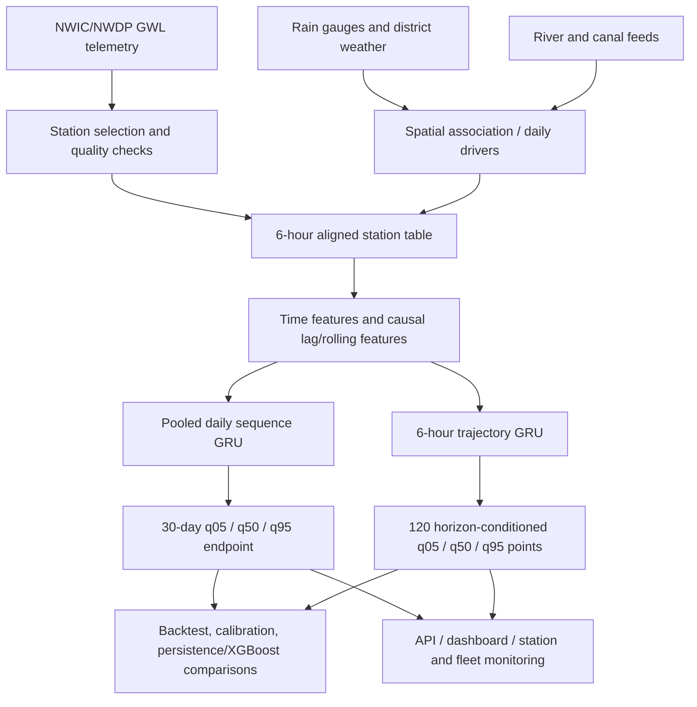

# AQUIS groundwater forecasting: ML research and paper-writing dossier

**Prepared:** 2026-11-02  
**Purpose:** evidence-backed working document for drafting the AQUIS research paper. It describes the repository as inspected, separates the model products and evaluation snapshots, and compares them with the papers saved under [`pprs/`](pprs/). It is not a final manuscript or a claim that every reported artifact comes from one frozen run.

> **Use this as a source of paper content, not as permission to copy every number into the abstract.** The repository contains artifacts generated at different times. For a publishable headline result, rerun the corrected leakage-purged pipeline on a frozen dataset and save row-level predictions.

## 1. Paper-level finding

AQUIS is best described as a **data-driven groundwater-level forecasting and monitoring pipeline with two direct GRU forecast products**, quantile uncertainty, explicit persistence comparisons, and a local operational refresh/serving path. The model uses a standard GRU; the strongest research contributions are the end-to-end regional data/evaluation workflow and the multi-horizon forecast product, not a newly invented recurrent architecture.

The best currently saved results show modest improvement over persistence for the pooled 30-day task and promising short-horizon trajectory scores on one historical sample. The trajectory product weakens substantially by 15–30 days under station-wise metrics. The evidence does **not** establish station-held-out generalization, universal superiority over XGBoost, a closed groundwater water balance, or production readiness across regimes.

## 2. Draft abstract (safe starting point)

Groundwater-level forecasts can support monitoring and planning, but regional time series are irregular, heterogeneous, and affected by unobserved abstraction and local hydrogeology. We describe AQUIS, a data-driven workflow for forecasting groundwater-level change from monitoring telemetry in Uttar Pradesh, India. The system aligns observations to a six-hour grid and serves two direct forecast products: a pooled 30-day endpoint model and a horizon-conditioned trajectory model extending to 120 six-hour steps. Both use gated recurrent units (GRUs) with quantile outputs; evaluation includes persistence and XGBoost references, point-error scores, and empirical interval coverage. In a saved rolling 2026 endpoint benchmark spanning nine origins and 510 stations, the pooled GRU obtains an RMSE of 1.299 m and MAE of 0.693 m, approximately 7% lower than persistence, while remaining close to XGBoost. A separate historical trajectory backtest reports a 30-day RMSE of 1.802 m versus 1.907 m for persistence, with calibrated 90% interval coverage of 0.894. Station-wise analysis of that trajectory artifact shows median NSE of 0.967 at one day, 0.772 at seven days, and 0.132 at 30 days, indicating substantial horizon-dependent degradation. These results are preliminary: the saved trajectory artifacts predate the current target-time purge, forecast windows overlap, and station-held-out generalization is not supported by existing experiments. AQUIS should therefore be presented as an operational research prototype with measurable baseline skill and explicit limitations, rather than as a universally superior or production-validated groundwater model.

**Before submission:** replace this abstract’s results with a new run after the corrected label-time purge, include the evaluation dates and station count, and confirm that the endpoint and trajectory metrics use the same stated data snapshot and evaluation protocol.

## 3. Research questions and defensible contributions

### Questions the current system can address

1. How accurately can a shared model forecast groundwater-level change at one 30-day endpoint across many monitored stations?
2. How does a direct horizon-conditioned GRU perform from six hours through 30 days compared with persistence and a tree-based model?
3. Do calibrated q05/q50/q95 prediction bands achieve their nominal empirical coverage on held-out forecast anchors?
4. What does it take to connect a regional groundwater forecast model to data-quality checks, refresh, API responses, and an inspection dashboard?

### Claims that fit the evidence

- A shared GRU can produce direct six-hourly trajectory forecasts and a separate direct 30-day pooled endpoint forecast from regional station telemetry.
- On the saved rolling 2026 endpoint benchmark, GRU improves pooled RMSE and MAE by about 7% relative to persistence and performs close to XGBoost.
- The saved trajectory backtest shows horizon-dependent performance: stronger station-wise skill at 1–7 days, with materially weaker station-wise efficiency at 15–30 days.
- The repository contains an uncertainty path using quantile predictions and post-fit widening/calibration, and it records empirical coverage.
- The system combines model inference with data-quality/regime-shift checks and operational data refresh/serving code.

### Claims to avoid

- “AQUIS is more accurate than all previous groundwater models.” The studies use different places, targets, periods, depths, cadences, and validation protocols.
- “The GRU architecture is novel.” It is a standard GRU with horizon-conditioned quantile heads in the trajectory model and a sequence GRU in the pooled model.
- “The system generalizes to unseen stations.” Existing corrected station-held-out work does not support this claim.
- “NSE/R² proves production suitability.” Aggregate or pooled scores hide weak stations and do not quantify operational consequences.
- “Rainfall minus ET₀ is recharge” or “AQUIS calculates the full aquifer balance.” It does not; the new ET₀ input is a modeled reference-grass estimate and groundwater extraction remains unavailable.
- Directly rank AQUIS’s metre RMSE against numbers from shallow Dutch wells, seasonal Indian observations, or electricity/COVID datasets.

## 4. AQUIS workflow, from raw data to prediction

### 4.1 Target and time grid

- Primary signal: groundwater level (GWL) from local NWIC/NWDP observation archives and refresh feeds.
- Main aligned table: six-hourly slots at 00, 06, 12, and 18; exact repository paths include `ml/data/aligned/table_6h.parquet` and the processing scripts `ml/04b_align_6h.py` and `ml/14_6h_features.py`.
- Target is **change**, not raw absolute level: `GWL(t + h) − GWL(t)`. Predicted change is added back to the observed anchor for a level forecast. This gives persistence the natural zero-change prediction and avoids asking the model to reproduce each station’s datum.
- The trajectory model predicts every horizon directly; it does not recursively feed its own prediction back as observed GWL.
- Exact station/time lookup is used for labels so a missing six-hour slot is not silently replaced by the next row.

### 4.2 Station selection and temporal population

The ML guide describes an initial selected population of 600 of 1,353 stations, spanning 29 districts under a 2026 coverage rule. Training metadata for another saved build describes 548 stations and 37 districts. These counts are **different snapshots/configurations**; do not combine them or choose one as the universal study population without freezing and recounting the input data used for the final experiment.

The selected-well criterion in `ml/01_select.py` requires 2026 coverage in at least eight months from January–September, a first 2026 observation no later than January 15, and a final observation on or after August 1. The source and model artifacts may therefore describe different subsets after refresh or regeneration.

### 4.3 Inputs and their limitations

| Input | Repository handling | Model/report caveat |
|---|---|---|
| GWL observations | Station time series are cleaned, quality-screened, and aligned to the six-hour grid. | Stale anchors, sparse history, sensor/datum shifts, and missing rows affect availability and skill. |
| Rainfall | Gauge-to-well association is built during alignment; Open-Meteo district rainfall is also used in future-driver code. Rain memory/API and rolling totals are used in some model paths. | Gauge coverage and spatial mismatch are uneven. A rain field existing in an aligned frame does not prove it was in every frozen model schema. |
| Weather | Open-Meteo district-centroid temperature, humidity, pressure, wind, and radiation are kept in a daily local Parquet. | Daily grid-cell estimates are not well measurements. Forecast drivers are forecasts only for their issue window; historical realized weather must not leak into a past forecast. |
| Reference ET₀ | This update adds Open-Meteo FAO-56 Penman–Monteith reference ET₀ as daily `et0_mm` to the weather fetch, and a district-level P−ET₀ climate indicator to the Streamlit water-balance page. | It is reference-grass ET₀, not actual ET, effective rainfall, percolation, or recharge. Current refresh populated 30/37 districts; seven were rate-limited (HTTP 429), so coverage is not yet complete. The page reports unavailable data for districts without ET₀. |
| River | CWC/FMIS river observations/forecasts are associated where covered. | Coverage is partial; a nearby river level is not automatically the local aquifer head. |
| Canal/reservoir | Local data are exploratory and sparse. | Do not describe sparse/empty feeds as universal predictive inputs. |
| Pumping/extraction | No `ml/data/soil/cgwb_extraction_district.csv` is present. | This is a major unobserved forcing, especially in UP. The page remains a recharge-condition/climate-context view, not a closed water balance. |

Open-Meteo documents `et0_fao_evapotranspiration` as a daily reference-ET₀ sum based on FAO-56 Penman–Monteith. FAO guidance distinguishes precipitation from effective rainfall/recharge because runoff, soil retention, and deep percolation also determine where rainwater goes. The dashboard therefore labels P−ET₀ as a climatic surplus/deficit indicator, never as recharge. See [Open-Meteo Historical Weather API](https://open-meteo.com/en/docs/historical-weather-api), [FAO effective rainfall](https://www.fao.org/4/s2022e/s2022e03.htm), and [FAO rainfall and evapotranspiration](https://www.fao.org/4/r4082e/r4082e05.htm).

### 4.4 Feature construction and leakage control

The main pipeline creates time-derived and lag/rolling features from aligned GWL and driver streams. Feature families include recent groundwater level/deviation/slope and observed/imputed status, rainfall/API summaries, calendar seasonality, and selected weather/river/canal values. The frozen trajectory schema is documented as 30 base numeric columns plus explicit horizon encodings (`h`, `h_sin`, `h_cos`) for the XGBoost trajectory product; the trajectory GRU uses its configured 30 numeric inputs and a horizon-conditioned head. The pooled daily GRU instead builds one daily record per station/day from the last six-hourly observation and uses 39 feature columns with a 60-day input sequence.

**Do not call every available feature an input to every model.** The code has distinct feature paths and frozen schemas. In particular, some hydrology columns are carried in the table but excluded from the frozen trajectory models; the pooled GRU uses a different subset.

Current target-time purge logic removes training/validation examples whose **future label timestamp** crosses the split boundary. The documented split uses anchors before 2025-10-01 for training, 2025-10-01 through 2025-12-31 for validation, and 2026-01-01 onward for test, with label-time purging at each boundary. Some saved historical models/backtests predate this correction. The saved DL trajectory backtest below explicitly dates from October 27; a corrected-pipeline paper claim requires regenerating features, model, calibration, and backtest.

### 4.5 Forecast products (keep them separate)

| Product | Model/data shape | Output | How to describe it |
|---|---|---|---|
| Pooled direct 30-day endpoint | Daily pooled GRU, 60-day input sequence, 39 features, three pinball-loss quantile heads, saved 3-seed ensemble (42, 840, 2056). | One q05/q50/q95 estimate of the day-30 level change per station/anchor. | A single direct endpoint, not 120 separate predictions. |
| Six-hourly trajectory | Sequence GRU over up to 120 previous 6-hour records, mask/left-padding for short histories, horizon-conditioned quantile heads. | Direct q05/q50/q95 predictions at 120 horizons from 6 h to 30 d. | A direct multi-horizon trajectory; model each horizon explicitly, not recursive simulation. |

Both are GRU products but use different training inputs, cadence, target frame, backtest artifacts, and evaluation sample. Their RMSEs are not interchangeable.

### 4.6 Uncertainty and serving

- Quantile outputs: q05, q50, q95; q50 is the median forecast and q05–q95 is a prediction band, not a guarantee.
- Calibration widens prediction intervals from held-out evidence. Coverage should always be reported alongside interval width/sharpness, because a very wide interval can achieve high coverage without being useful.
- The trajectory runtime confidence combines interval quality, performance against persistence, direction, width, station integrity, driver availability, anchor out-of-distribution evidence, and trajectory stability.
- Local runtime configuration can select DL and retain XGBoost as fallback. A backend selected in `data/refresh/runtime.json` is not a model-promotion certificate.
- Operational pieces include the Flask API, scheduled/incremental refresh code, and Streamlit showcase. The showcase reads saved artifacts; it is not the training service.

## 5. Current saved quantitative evidence

### 5.1 Newer rolling 30-day pooled benchmark

Source: [`ml/outputs/benchmark_2026/benchmark_2026.md`](../ml/outputs/benchmark_2026/benchmark_2026.md), using a data table through 2026-10-29 and nine forecast origins, 2026-01-10 to 2026-09-07.

| Model | Rows | Stations | MAE (m) | RMSE (m) | Difference vs persistence |
|---|---:|---:|---:|---:|---|
| Persistence | 3,950 | 510 | 0.747 | 1.399 | Reference |
| XGBoost | 3,950 | 510 | 0.673 | 1.302 | RMSE −6.9%; MAE −9.9% |
| DL-GRU | 3,950 | 510 | 0.693 | 1.299 | RMSE −7.2%; MAE −7.3% |

Interpretation: the pooled GRU improves on persistence but is essentially tied with XGBoost in RMSE in this benchmark (1.299 vs 1.302 m). XGBoost has lower MAE. The forecast is not uniformly superior across origins; the source table documents origins where DL error improves and worsens relative to persistence. The latest evaluable origin (2026-09-07) has GRU RMSE 1.035 m, XGBoost 1.014 m, and persistence 1.095 m.

The rolling benchmark’s `rows.csv` preserves paired station-origin predictions, so additional station-wise metrics can be calculated for this artifact. Among 500 stations with at least five evaluated origins (each has only 5–9 origins), median station NSE/R² is **0.345** for GRU, **0.368** for XGBoost, and **0.142** for persistence. Median station RMSE / observed range is **27.27%**, **26.43%**, and **30.32%**, respectively. Only **31.8%** of these GRU stations exceed NSE 0.5, and **1.4%** have range-normalized RMSE below 10%. The GRU station RMSE is below persistence at 77.4% of stations but below XGBoost at 45.2%. This is mixed site-level skill, not a uniform GRU advantage. Because there are only 5–9 origins per station and the observed range spans a limited set of seasonal targets, these site-level NSE/range scores are descriptive and noisy. See the updated threshold assessment for calculations.

### 5.2 Separate saved pooled 3-seed evaluation

Source: [`ml/outputs/pooled_dl_eval.json`](../ml/outputs/pooled_dl_eval.json), saved 2026-10-27. This is a **separate snapshot/protocol** from §5.1.

| Metric | DL-GRU | Persistence | Pooled XGBoost reference |
|---|---:|---:|---:|
| Rows / stations | 4,355 / 511 | 4,355 / 511 | Same sample; `E0` in JSON |
| RMSE | 2.082 m | 2.187 m | 2.206 m |
| MAE | 0.751 m | 0.839 m | 0.826 m |
| Bias | −0.030 m | −0.097 m | −0.181 m |
| Direction accuracy | 0.732 | 0.002 (as recorded) | 0.711 |
| 90% interval empirical coverage | 0.925 calibrated | — | — |
| Paired RMSE ratio vs persistence | 0.952 [0.906, 0.972] | — | — |
| Paired RMSE ratio vs XGBoost | 0.944 [0.879, 0.972] | — | — |

The paired intervals exclude 1 for this saved sample; this supports an improvement on that sample/protocol, not a promise about future dates or unseen stations. Coverage alone does not establish a narrow/useful band.

### 5.3 Saved 6-hourly trajectory GRU evaluation

Source: [`ml/outputs/traj_backtest_summary_dl.json`](../ml/outputs/traj_backtest_summary_dl.json) and [`ml/outputs/traj_paired_ci_dl_vs_xgb.json`](../ml/outputs/traj_paired_ci_dl_vs_xgb.json), generated 2026-10-27. It scores 19,406 anchor/horizon rows across 150 stations from 2025-10-01 to 2026-08-20. Anchors are 14 days apart, so forecast windows overlap and are statistically dependent.

| 30-day metric | Trajectory GRU | Persistence | Interpretation |
|---|---:|---:|---|
| RMSE | 1.802 m | 1.907 m | GRU improves about 5.5% on this artifact. |
| Direction accuracy | 0.725 | — | Sign accuracy, not magnitude accuracy. |
| Calibrated 90% coverage | 0.894 | — | Near nominal on the recorded calibration split; show interval width too. |
| Promotion status | `promote_trajectory = false` | — | Saved gate did not approve promotion. |

Paired station bootstrap reports GRU/XGBoost RMSE ratios about 1.012 at 6 h, 1.003 at 12 h, 0.962 at 48 h, 0.985 at 15 d, and 0.990 at 30 d. Thus, DL does not win every horizon; `dl_beats_xgb_all_horizons` is false. A trajectory backtest summary also records `success_short_horizons = false`.

### 5.4 Station-wise threshold check on trajectory rows

The report [`ml/outputs/benchmark_2026/model_threshold_assessment.md`](../ml/outputs/benchmark_2026/model_threshold_assessment.md) recalculates metrics from paired rows in `traj_backtest_rows_dl.parquet`. It computes per-station NSE using `1 − SSE/SST`, then reports the median station score; it also computes each station’s RMSE divided by that station’s observed range, then takes the median. At least 10 scored rows are required per station/horizon (137 stations qualify). This avoids inflating pooled efficiency with differences in station datums.

| Horizon | Median station NSE / R²* | Median station RMSE/range | RMSE (m) | MAE (m) | Reading |
|---|---:|---:|---:|---:|---|
| 1 day (24 h) | 0.967 | 5.12% | 0.786 | 0.130 | Good efficiency and relative range error; RMSE exceeds the proposed 0.2–0.5 m short-term band. |
| 7 days (168 h) | 0.772 | 14.13% | 1.402 | 0.294 | NSE clears 0.5; range-normalized and absolute RMSE heuristics do not. |
| 15 days (360 h) | 0.475 | 20.90% | 1.355 | 0.432 | Median station efficiency falls below 0.5. |
| 30 days (720 h) | 0.132 | 26.93% | 1.802 | 0.660 | Station-wise efficiency/range criteria fail; RMSE is within the supplied 1–2 m seasonal band. |

\* Here R² uses the same `1 − SSE/SST` definition as NSE, so it is not an independent score. Some software instead reports squared correlation. These threshold values are user-supplied screening heuristics, not universal hydrology certification bands; see the assessment report for caveats and external sources. The pooled endpoint and trajectory horizons are separate products and validation samples.

## 6. How the saved papers compare

The five identified PDFs correspond to groundwater studies (Pandey; Taccari) and general/other-domain forecasting studies (Wu; ArunKumar; Zhang). They inform framing and evaluation design, but **their headline errors should not be ranked against AQUIS** because the data, target, cadence, depth range, geography, and test splits differ.

| Paper saved in `paper/pprs/` | Task/data/method (verified paper description) | What it contributes to AQUIS discussion | Important difference / comparison limit |
|---|---|---|---|
| `sustainability-12-08932-v2.pdf` — Pandey et al. (2020), GA-ANN seasonal groundwater table depth in Uttar Pradesh | 38 observation wells in the Ganga–Hindon area; 21 years (1994–2014); pre-/post-monsoon seasonal targets; 18 GA-ANN configurations using groundwater recharge/discharge and previous levels. | Closest regional groundwater prior. Cite to establish that UP GWL prediction has been studied and distinguish AQUIS by six-hourly telemetry, regional breadth, 30-day/multi-horizon tasks, baseline comparisons, and forecast uncertainty. | Seasonal observations are not sub-daily rolling forecasts; target/inputs/period differ. Do not compare Pandey’s reported R² directly to AQUIS station/time pooled R². Confirm the exact split and test-only metric in the PDF before quoting the best headline value. DOI: [10.3390/su12218932](https://doi.org/10.3390/su12218932). |
| `s41598-024-75385-2.pdf` — Taccari et al. (2024), spatial-temporal GNN for groundwater | Overbetuwe, Netherlands: 213 piezometers and 395 depth-specific GWL series; 200 most-complete series selected; weekly analysis; modified MTGNN with predefined spatial graph; precipitation, evaporation, river stages, and pumping inputs. Paper evaluates synthetic and measured series and includes MODFLOW-generated synthetic data. | Closest deep-learning groundwater comparator. It demonstrates why spatial graphs and exogenous pumping/physical benchmarks are meaningful; use AQUIS’s lack of explicit spatial edges, extraction, and physical simulation as limitations/future work. | Shallow water table (about 0.8–4.2 m), Dutch polder, weekly observations, and different experimental protocol. Their reported RMSEs must not be directly ranked against AQUIS’s metre errors. DOI: [10.1038/s41598-024-75385-2](https://doi.org/10.1038/s41598-024-75385-2). |
| `1-s2.0-S1876610219309981-main.pdf` — Wu et al. (2019), GRU short-term electricity load with electricity-price effects | New South Wales power/load and electricity-price series; historical clustering/classification then GRU; three GRU layers with ten cells each; training 2006–2009, validation Jan–Jun 2010, later observations for test. | A peripheral example of using GRU with external drivers and point forecasting. It may support the general time-series method background. | It is electricity-load forecasting, not groundwater. Do not cite it as evidence AQUIS outperforms groundwater methods. DOI: [10.1016/j.egypro.2019.01.950](https://doi.org/10.1016/j.egypro.2019.01.950). |
| `1-s2.0-S1110016822000138-main.pdf` — ArunKumar et al. (2022), GRU/LSTM vs ARIMA/SARIMA for COVID-19 trends | Country-specific cumulative COVID-19 confirmed/recovered/death series for ten countries; 60-day forecasting; compares GRU, LSTM, RNN and ARIMA/SARIMA model families. | Useful methodological context: deep learning is not guaranteed to dominate statistical baselines in every series, supporting AQUIS’s transparent persistence/XGBoost comparisons and non-universal claims. | Disease counts have different dynamics, targets, units, and decision context. No metric-value comparison with GWL is meaningful. DOI: [10.1016/j.aej.2022.01.011](https://doi.org/10.1016/j.aej.2022.01.011). |
| `s41598-024-53460-y.pdf` — Zhang et al. (2024), extreme-event adaptive GRU (eGRU) | A new GRU cell tested on four multivariate benchmarks (solar energy, traffic, electricity, exchange rates); compares many RNN variants and LSTNet/TPA-LSTM; reports component/input-length/segmentation ablations and repeats experiments five times for mean/standard deviation. | A useful standard for ablations, repeated runs, validation-based model selection, and benchmark breadth. AQUIS should add trajectory seeds and ablations before making a strong deep-learning contribution claim. | eGRU proposes a new architecture; AQUIS currently uses a standard GRU. These four benchmarks are not groundwater, and their scores are not comparable to AQUIS. DOI: [10.1038/s41598-024-53460-y](https://doi.org/10.1038/s41598-024-53460-y). |

The Taccari article describes 395 series but selects 200 for its principal well graph after excluding series with more than 20% missing data; these counts are not contradictory. This distinction is important when summarizing its scale.

The Claude review notes that an unrelated district-heating/Andrić article was appended to the supplied Wu PDF. Keep those unrelated pages out of the comparison and bibliography.

### 6.1 Comparison narrative ready to adapt

“Prior groundwater-level forecasting studies have used seasonal GA-ANN models in Uttar Pradesh and spatial-temporal graph networks in the Overbetuwe polder. AQUIS addresses a different forecasting regime: station telemetry aligned to six-hour intervals, a direct 120-step trajectory and a separate pooled 30-day endpoint, with quantile intervals and explicit persistence evaluation. The designs are not directly ranked by RMSE because their observation cadence, aquifer setting, forecast target, and validation period differ. Taccari et al. explicitly encode well-to-well and exogenous-node connectivity and include pumping and physical-model-derived synthetic data; AQUIS currently shares GRU weights across station sequences but has no explicit spatial graph or pumpage input. Accordingly, AQUIS’s contribution is the operational evaluation and regional forecasting workflow rather than a new recurrent architecture or demonstrated superiority over spatial/physical models.”

## 7. Evaluation protocol and metrics to report

### Required baseline comparisons

- **Persistence:** predict no change from the current level; mandatory reference for forecast skill.
- **XGBoost:** incumbent/strong tabular reference; compare on paired station-anchor rows and by horizon.
- **Seasonal climatology:** useful secondary reference where the target and split make it well-defined.
- Report the exact split, target-time purge, stride, stations, dates, horizon, exclusions, and whether rows overlap.

### Metric definitions

- **RMSE (m):** square root of mean squared level error. Sensitive to large errors.
- **MAE (m):** mean absolute level error; more robust to a few large misses.
- **Bias (m):** signed average `prediction − observation`.
- **Direction accuracy:** fraction with matching sign of predicted and observed change; it does not measure change magnitude.
- **NSE:** `1 − Σ(y − ŷ)² / Σ(y − mean(y))²`; calculate per station and horizon, then provide the distribution (median, quartiles, and fraction above thresholds). The 0.5 and 0.75 bands are context-dependent hydrology heuristics, not a universal production standard.
- **R²:** define the exact formula and aggregation. If using `1 − SSE/SST`, it is the same expression as NSE on the same station/horizon data; if using squared correlation, report that separately and do not call it interchangeable with NSE.
- **Range-normalized RMSE:** per station `RMSE / (max(y) − min(y)) × 100%`; report its distribution and station fraction under 10%. Do not divide by the range pooled across wells with different datums.
- **Prediction interval:** empirical q05–q95 coverage and mean/median width, ideally by horizon and station group. State calibration/test split explicitly.
- **Paired bootstrap:** resample stations, not rows, for model-vs-model ratios; show confidence interval and mark ties/uncertain outcomes when the interval crosses 1.

## 8. Draft methods section outline

1. **Study domain and observations:** UP region, monitoring network, source institutions, station-selection rule, observation period, station counts and district counts from one frozen table.
2. **Time alignment and quality control:** six-hour grid, timezone convention, missing-data handling, spike/datum checks, station exclusions and telemetry freshness.
3. **Driver data:** rainfall association, Open-Meteo weather/reference ET₀, river/canal coverage and forecast-vs-observation provenance; make clear that no pumpage data are present.
4. **Targets and products:** delta target equation; pooled one-point 30-day daily task; trajectory 6-hourly horizons `h=1..120`.
5. **Models:** GRU sequence context and horizon-conditioned heads; quantile pinball losses; ensemble seeds for pooled model; XGBoost baseline; no architecture novelty claim.
6. **Temporal validation:** chronological train/validation/test boundaries and target-time purge; point-in-time driver rules; origin cadence and non-overlap/dependence limitations.
7. **Metrics and uncertainty:** RMSE, MAE, bias, direction, station-wise NSE/R², range-normalized RMSE, interval coverage and width, station bootstrap.
8. **Operational path:** refresh/data quality/API/dashboard as system implementation; evaluate availability/reliability separately from predictive accuracy.

## 9. Results-section structure (draft plan)

1. **Data coverage:** station-month coverage, driver availability, missingness, station-level observation counts, and exact frozen dataset end date.
2. **Pooled 30-day endpoint:** GRU vs persistence and XGBoost on identical origins; pooled and per-station errors; origin-specific changes.
3. **Trajectory horizon curve:** RMSE/MAE, persistence skill, NSE distribution, NRMSE distribution, quantile coverage and width from 6 h to 30 d.
4. **Uncertainty:** calibrated vs raw coverage on disjoint calibration/evaluation anchors; interval width and failure cases.
5. **Robustness:** seed variability, ablations, year/regime split, station-held-out protocol (only after proper refit), performance by district/depth/data quality.
6. **Operational checks:** forecast availability, stale station rate, fallback rate, uncertainty/confidence downgrade frequencies, and data-source status. Keep these separate from accuracy claims.

### Suggested figures/tables

- Map of stations and districts with training/evaluation counts (no station PII beyond what is public/authorized).
- Coverage/missingness calendar for GWL and each driver.
- Horizon curve: GRU/XGBoost/persistence RMSE and MAE with station-bootstrap confidence intervals.
- Horizon-wise station NSE and range-normalized-RMSE distributions (box/violin + threshold fractions).
- q05–q95 calibration plot: nominal vs observed coverage and interval width by horizon.
- Ablation table: history length, weather/rain drivers, horizon conditioning, quantile calibration, and seeds.
- A simple pipeline diagram; avoid a decorative neural-network diagram that does not match the code.

## 10. Limitations to state plainly

1. **Historical artifact age:** DL trajectory row artifact is saved 2026-10-27 and ends at 2026-08-20; pooled rolling benchmark ends at origin 2026-09-07 with targets through roughly October. Neither reflects a full evaluation through the latest GWL observation (2026-10-29).
2. **Old pre-purge outputs:** some saved model/backtest artifacts predate target-time purging. Regenerate before treating their scores as corrected held-out evidence.
3. **Overlapping forecast windows:** trajectory origins are 14 days apart while the horizon extends 30 days (`no_overlap_windows: false`), so rows are not independent.
4. **Weak long horizon:** station-wise trajectory NSE median is 0.132 at 30 days; the 10th-percentile station NSE is −2.025. A decent fleet-average RMSE can hide poor wells.
5. **No demonstrated new-station skill:** corrected station-held-out experiments do not support transfer to unseen locations. Shared weights do not create spatial knowledge by themselves.
6. **No explicit spatial graph or physical model:** unlike Taccari et al., AQUIS does not represent neighboring wells as graph nodes and does not benchmark against a local MODFLOW simulation.
7. **Pumpage absent:** no extraction/pumping dataset was found. The water-balance page is not a physical aquifer balance.
8. **ET₀ status:** code now requests provider-computed FAO-56 reference ET₀ and the page can display district P−ET₀; the 2026-11-02 refresh populated 30 of 37 districts, with seven HTTP 429 failures. This is modeled reference ET₀, not actual ET or recharge. These ET₀ values are not claimed as a trained forecast feature.
9. **Variable station coverage:** rain gauges and other drivers are spatially sparse; district weather is a centroid proxy. Driver availability varies by station and date.
10. **Absolute thresholds are not universal:** 0.2–0.5 m daily/weekly and 1–2 m seasonal limits may be useful screening rules supplied for this analysis, but operational acceptability depends on local variability, datum, purpose, warning lead time, and error cost.
11. **R² ambiguity:** a common model-score R², an NSE-form score, and squared Pearson correlation differ. State formula and station-level aggregation.
12. **Technology/runtime snapshots:** local configuration may select GRU, but a current backend selection or successful API response does not prove a candidate passed promotion or that the remote deployment is current.

## 11. Highest-value work before submission

1. Freeze the current input data and regenerate features/models/backtests under target-time purge. Log commit, data hashes, versions, dates, and station counts.
2. Save paired row-level predictions for the pooled endpoint and trajectory products, including actual, q05/q50/q95, persistence, XGBoost, station, origin, target time, and source/provenance fields.
3. Add trajectory GRU seed repetitions and report mean ± standard deviation; run the architecture/input ablations benchmarked by Zhang et al.
4. Use station-group holdout by fitting on training stations only and evaluating truly unseen stations; do not just partition predictions from a model trained on all stations.
5. Report station-level distributions/worst strata and reliability by horizon; examine the weak 15–30 day wells.
6. Reassess interval coverage and width on a disjoint time/origin set after calibration.
7. Resolve Open-Meteo 429s for the seven districts and record the weather artifact’s date/source coverage. Keep modeled ET₀ and observed rainfall semantics explicit.
8. If claiming water-balance interpretation, acquire and validate extraction, soil/storage, runoff/recharge, and local ET information. Until then use “rainfall condition” or “district climatic surplus/deficit” language.

## 12. Repository map for writing and reproducibility

| Question | Source files / artifacts |
|---|---|
| Overall data/model architecture | [`ml/ML_MODULE_GUIDE.md`](../ml/ML_MODULE_GUIDE.md), [`ml/README.md`](../ml/README.md), [`docs/ml.md`](../docs/ml.md) |
| Station selection and preprocessing | `ml/pipeline_data.py` (select, align6 stages), `ml/pipeline_model.py` (features, features6h stages) |
| Pooled GRU architecture/training | `ml/pipeline_traj_dl.py` (train_pooled_dl, backtest_pooled_dl stages), `ml/models/pooled_dl_config.json`, `ml/outputs/pooled_dl_eval.json` |
| Trajectory data/training/inference | `ml/pipeline_traj.py` (datasets stage), `ml/pipeline_traj_dl.py` (train_dl stage), `ml/serving_engines.py`, `ml/serving_core.py` |
| Trajectory backtests/calibration/reliability | `ml/pipeline_traj.py` (backtest, reliability, paired_ci stages), `ml/outputs/traj_backtest_summary_dl.json`, `ml/outputs/traj_backtest_rows_dl.parquet`, `ml/outputs/traj_paired_ci_dl_vs_xgb.json` |
| Current endpoint comparison | `ml/outputs/benchmark_2026/benchmark_2026.md` |
| Threshold calculations | [`ml/outputs/benchmark_2026/model_threshold_assessment.md`](../ml/outputs/benchmark_2026/model_threshold_assessment.md) |
| Data-quality/research failure modes | `ml/outputs/benchmark_2026/decline_investigation.md`, `ml/data/scratch_exp/REPORT.md`, `ml/outputs/diagnostics_phase1/phase1_report.md` |
| Weather and climate indicator | `ml/openmeteo_weather.py`, `ml/refresh/refresh_data.py`, `ml/app_pages/water_balance.py`, `ml/data/cfs/openmeteo_weather_daily.parquet` |
| Service and UI | `ml/api.py`, `ml/streamlit_app.py`, `ml/app_pages/` |
| Reference PDFs | [`paper/pprs/`](pprs/) |

## 13. Reference list

1. Pandey, K., Kumar, S., Malik, A., & Kuriqi, A. (2020). “Artificial Neural Network Optimized with a Genetic Algorithm for Seasonal Groundwater Table Depth Prediction in Uttar Pradesh, India.” *Sustainability*, 12(21), 8932. [doi:10.3390/su12218932](https://doi.org/10.3390/su12218932).
2. Taccari, M. L., Wang, H., Nuttall, J., Chen, X., & Jimack, P. K. (2024). “Spatial-temporal graph neural networks for groundwater data.” *Scientific Reports*, 14, 24564. [doi:10.1038/s41598-024-75385-2](https://doi.org/10.1038/s41598-024-75385-2).
3. Wu, W., Liao, W., Miao, J., & Du, G. (2019). “Using Gated Recurrent Unit Network to Forecast Short-Term Load Considering Impact of Electricity Price.” *Energy Procedia*, 158, 3369–3374. [doi:10.1016/j.egypro.2019.01.950](https://doi.org/10.1016/j.egypro.2019.01.950).
4. ArunKumar, K. E., Kalaga, D. V., Kumar, C. M. S., Kawaji, M., & Brenza, T. M. (2022). “Comparative analysis of Gated Recurrent Units (GRU), long Short-Term memory (LSTM) cells, autoregressive Integrated moving average (ARIMA), seasonal autoregressive Integrated moving average (SARIMA) for forecasting COVID-19 trends.” *Alexandria Engineering Journal*, 61(10), 7585–7603. [doi:10.1016/j.aej.2022.01.011](https://doi.org/10.1016/j.aej.2022.01.011).
5. Zhang, Y., Wu, R., Dascalu, S. M., & Harris, F. C. Jr. (2024). “A novel extreme adaptive GRU for multivariate time series forecasting.” *Scientific Reports*, 14, 2991. [doi:10.1038/s41598-024-53460-y](https://doi.org/10.1038/s41598-024-53460-y).
6. Moriasi, D. N., et al. (2007). “Model Evaluation Guidelines for Systematic Quantification of Accuracy in Watershed Simulations.” *Transactions of the ASABE*, 50(3), 885–900. [USDA publication record](https://www.ars.usda.gov/research/publications/publication/?seqNo115=197994). These ratings are watershed-simulation guidance; apply to groundwater only with domain/context caveats.
